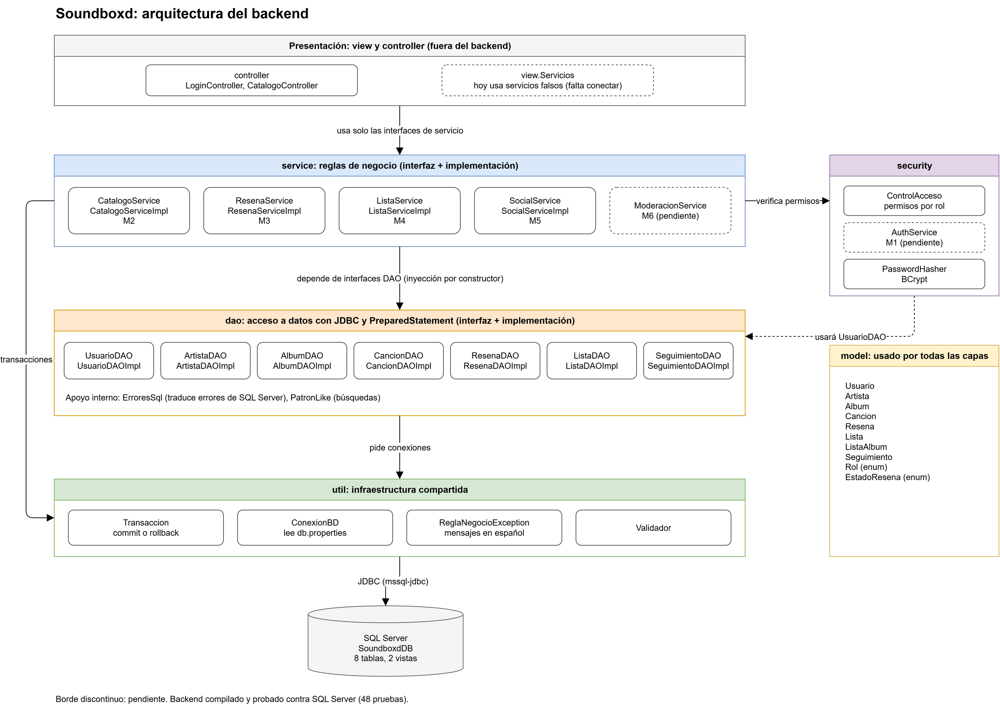
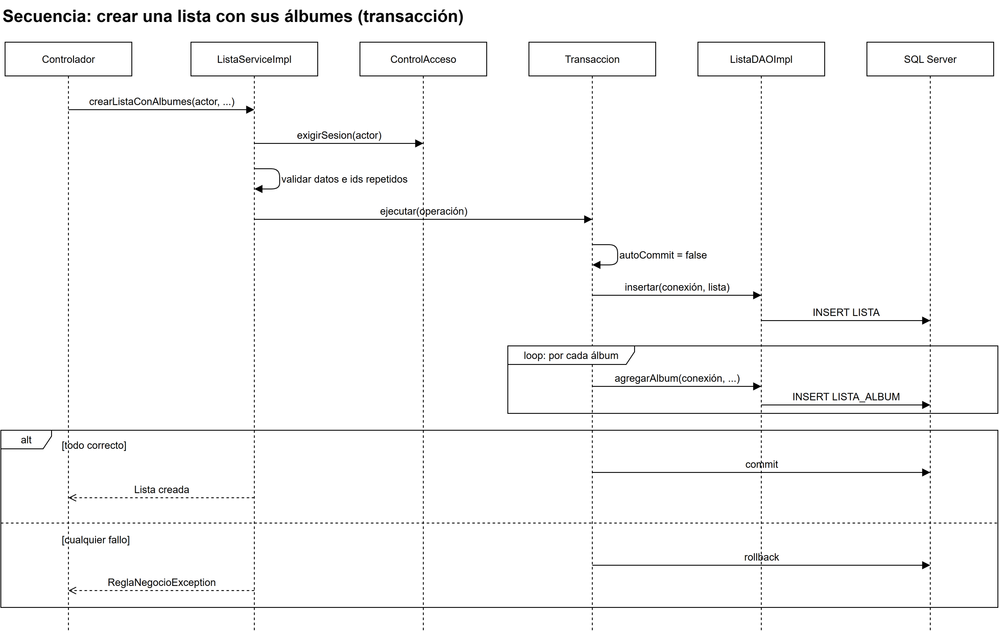
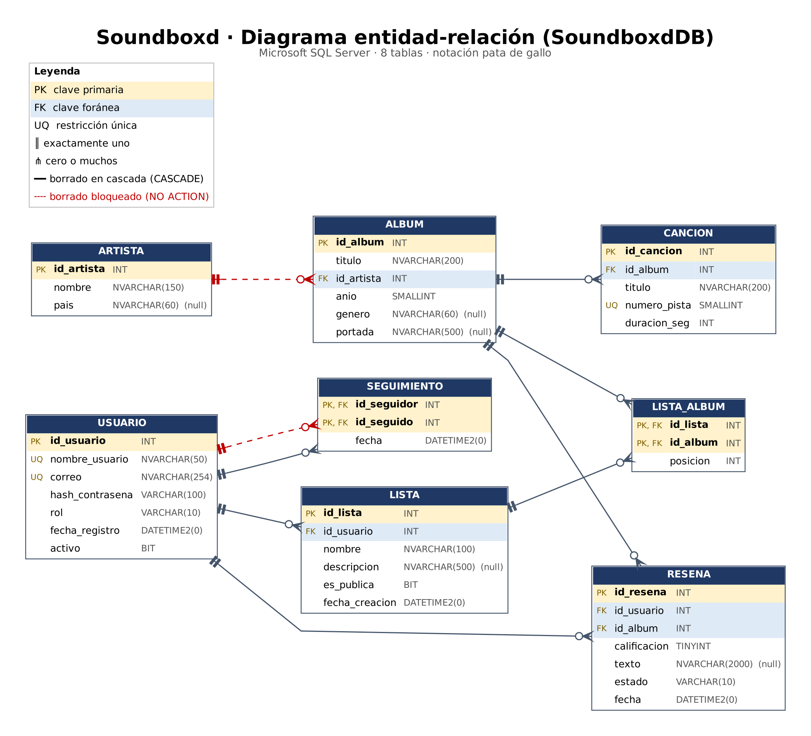

# Soundboxd

Plataforma social de escritorio para reseñar y listar música (análogo musical de Letterboxd).
Proyecto final del curso **Ingeniería de Software (CIB02)** – FIEE UNI.
Grupo 3 – Sección O. Docente: Ing. M.I.A. Homar Dávila Padilla.

## Integrantes

| Integrante | Rol |
|---|---|
| Valeria Solís | Base de datos |
| Amado Frías | Backend |
| Johan Oscco | Frontend y despliegue |
| Bryan Tapia | Seguridad, cuentas y pruebas |
| David Quispe | Diseño y gestión |

## Módulos

| Módulo | Contenido | Estado |
|---|---|---|
| M1 Cuentas | Registro, inicio de sesión y roles | En desarrollo |
| M2 Catálogo | Búsqueda de álbumes, canciones y promedio | Servicio listo |
| M3 Reseñas | Borrador, publicación, edición y calificación de 1 a 5 | Servicio listo |
| M4 Listas | Listas de álbumes públicas o privadas | Servicio listo |
| M5 Red social | Seguir usuarios y ver su actividad | Servicio listo |
| M6 Moderación | Reportar, ocultar y restituir reseñas | En desarrollo |

La interfaz tiene las pantallas de ingreso y catálogo, y todavía trabaja con datos de ejemplo en memoria.

## Tecnologías

- Java, JDK 21
- JavaFX (aplicación de escritorio)
- Patrón MVC
- Microsoft SQL Server vía JDBC (`mssql-jdbc`) con `PreparedStatement`
- Maven, JUnit 5 y jBCrypt
- IDE: IntelliJ IDEA 2025.3

## Arquitectura



Cada capa depende solo de la inferior:

| Paquete (`com.soundboxd`) | Responsabilidad |
|---|---|
| `view`, `controller` | Pantallas JavaFX; solo llaman a servicios |
| `service` | Permisos, reglas de negocio y transacciones |
| `dao` | Consultas SQL con `PreparedStatement` |
| `model` | Clases del dominio |
| `security` | Control de acceso y hash de contraseñas |
| `util` | Conexión, transacciones, validación y errores |

### Ejemplo: crear una lista con sus álbumes

La operación es atómica: si falla un álbum, no queda ni la lista ni ningún álbum.



El archivo editable de ambos diagramas es [`Arquitectura_Backend.drawio`](docs/diagramas/Arquitectura_Backend.drawio).

## Cómo ejecutarlo

### Requisitos

- JDK 21
- Maven (IntelliJ IDEA ya lo incluye)
- Microsoft SQL Server con TCP/IP en el puerto 1433 y autenticación de SQL Server

### 1. Crear la base de datos

En una copia local de `db-scripts/00_crear_bd_y_usuario.sql`, reemplaza `CAMBIAR_CLAVE` por una clave propia. Luego ejecuta, en este orden:

1. `00_crear_bd_y_usuario.sql`
2. `01_esquema.sql`
3. `02_datos_ejemplo.sql`
4. `03_vistas_consultas.sql`

No subas al repositorio el script con tu clave.

### 2. Configurar la conexión

Copia `src/main/resources/db.properties.example` como `db.properties` en la misma carpeta y escribe la clave que usaste. Git ignora ese archivo.

### 3. Ejecutar

```bash
mvn javafx:run
```

### Pruebas

```bash
mvn clean test
```

Las pruebas de base de datos se omiten si no hay conexión; revisa que el contador `Skipped` sea 0.

### Generar el ejecutable

```bash
mvn clean package
java -jar target/Soundboxd.jar
```

El `.jar` no incluye la clave: coloca tu `db.properties` en la misma carpeta que el `.jar`.

## Estructura del repositorio

| Carpeta | Contenido |
|---|---|
| `src/` | Código fuente y pruebas |
| `db-scripts/` | Scripts SQL de la base de datos |
| `db-backup/` | Respaldo de la base de datos |
| `docs/` | Diagramas, diccionario de datos, requerimientos y documento de sustentación |

## Base de datos



Detalle de tablas y columnas: [diccionario de datos](docs/diccionario-datos.docx).

## Backup de la base de datos

Ubicación: `/db-backup`. El archivo `RUTA.txt` indica el enlace de descarga y el nombre exacto del archivo `.bak`.

## Cómo contribuir

Cada integrante trabaja en su rama y une sus cambios a `main` mediante pull request con una aprobación.
