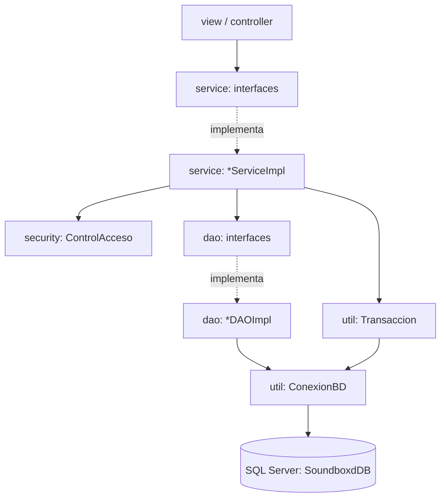

# Backend de Soundboxd: estado, arquitectura y cómo continuar

Responsable: Amado Frías. Actualizado el 25 de noviembre de 2026.

Documento para las personas del equipo y para quien retome el trabajo. Diagrama que lo acompaña: `docs/diagramas/Arquitectura_Backend.drawio` (página 1: capas; página 2: secuencia de crear una lista).

## 1. Resumen

| Punto | Estado |
|---|---|
| Proyecto | Plataforma de escritorio para reseñar y listar música (curso CIB02, Grupo 3) |
| Tecnología | Java 21, JavaFX, SQL Server, JDBC, Maven |
| Backend de los módulos M2 a M5 | Escrito, compilado y probado: 51 pruebas, 0 fallos, 0 omitidas |
| Dónde está | Rama `backend/dao-servicios` |
| En `main` | Todavía no al 26 de noviembre: requiere pull request, 1 aprobación y merge |
| Pantallas conectadas | No. `view/Servicios.java` todavía usa servicios falsos |
| Entrega final | 10 de diciembre (congelamiento: 5 de diciembre) |

## 2. Reglas para quien continúe

- Todo el acceso a datos es con `PreparedStatement`. Nunca se une texto del usuario al SQL.
- La vista solo llama a servicios; los DAO y servicios no usan JavaFX.
- Las interfaces de servicio son un contrato con las pantallas: no renombrar ni quitar métodos. Lo nuevo se agrega como `default`.
- `main` está protegida: pull request con 1 aprobación, sin `push --force`.
- Commits con la cuenta del responsable (`Adriel2503`).
- Mensajes explicativos: título `tipo(ámbito): qué hiciste` y cuerpo con qué pasaba, qué cambia y por qué.
- Antes de operar en GitHub: `gh auth switch --user Adriel2503`.
- No subir `db.properties`, `*.bak`, `target/` ni `.idea/`.
- Pedir confirmación al responsable antes de hacer `push` o abrir el pull request.

## 3. Cómo compilar y probar

La PC de trabajo no tiene Java ni SQL Server instalados en Windows; se usa Docker.

1. Base de datos: contenedor `soundboxd-sql` (SQL Server 2022, puerto local 1433), con `db-scripts/00` a `03` ya ejecutados. Si está detenido: `docker start soundboxd-sql`.
2. Conexión: `src/main/resources/db.properties` (ignorado por Git). En otra PC se copia de `db.properties.example` y se pone la clave de `soundboxd_app`.
3. Pruebas, desde PowerShell en la raíz del repositorio:

```powershell
docker run --rm --network container:soundboxd-sql -v "${PWD}:/app" -v soundboxd-m2:/root/.m2 -w /app maven:3.9-eclipse-temurin-21 mvn -B -ntp clean test
```

Si no hay base o `db.properties`, las pruebas de base de datos **se omiten en silencio**: revisar que `Skipped` sea 0.

## 4. Arquitectura



| Paquete | Contenido | Depende de | Responsable |
|---|---|---|---|
| `model` | `Usuario`, `Artista`, `Album`, `Cancion`, `Resena`, `Lista`, `ListaAlbum`, `Seguimiento`, `Rol`, `EstadoResena` | nada | Amado |
| `util` | `ConexionBD`, `Transaccion`, `ReglaNegocioException`, `Validador` | `db.properties` | Amado y Bryan |
| `dao` | 7 interfaces y sus `*Impl`; apoyo: `ErroresSql`, `PatronLike` | `model`, `util` | Amado |
| `service` | Catálogo, reseñas, listas, social (interfaz e `Impl`) y `ModeracionService` | `dao`, `model`, `security`, `util` | Amado; moderación: Bryan |
| `security` | `ControlAcceso`, `AuthService`, `PasswordHasher` | `model`, `util` | Bryan |
| `view`, `controller` | Navegación, sesión, pantallas, servicios falsos | `service`, `security`, `model` | Johan |

| Capa | Hace | No hace |
|---|---|---|
| Servicio | Permisos, validación, reglas, transacciones | SQL, JavaFX |
| DAO | SQL y mapeo; traduce `SQLException` a `ReglaNegocioException` | Reglas, permisos |
| Modelo | Datos | Acceso a datos |

Orden dentro de un método de servicio que modifica datos: permiso, validación, regla, DAO. Cuando hace falta saber quién es el dueño (reseñas, listas), primero se lee el registro y luego se comprueba el permiso.

### Decisiones

| Decisión | Motivo | Descartado |
|---|---|---|
| Tres capas | Lo pide el curso | Hexagonal: más código sin beneficio para 8 tablas |
| JDBC directo | Regla del curso | Spring, Hibernate |
| Inyección por constructor | Permite sustituir los DAO | Contenedor de inyección, singletons |
| Una conexión por operación | Aplicación de escritorio | Pool de conexiones |

Cada `*ServiceImpl` tiene un constructor sin argumentos (producción) y otro que recibe sus dependencias.

Patrones: DAO, Service Layer, inyección por constructor, Execute Around (`Transaccion`). SOLID: una responsabilidad por clase y servicios que dependen de interfaces de DAO. Concesiones: el constructor sin argumentos nombra clases concretas; `ListaDAO` expone `Connection`; `AuthService` y `ModeracionService` son clases, no interfaces.

## 5. Contrato de los servicios

`Usuario actor` es quien actúa; `null` es un visitante. Todos los errores salen como `ReglaNegocioException`, con mensaje en español listo para mostrar.

| Servicio | Métodos | Permiso |
|---|---|---|
| `CatalogoService` | `buscarAlbumes(texto)`, `obtenerAlbum(id)`, `listarCanciones(id)`, `promedioAlbum(id)` | Libre |
| | `crearAlbum(actor, album)`, `actualizarAlbum(actor, album)`, `eliminarAlbum(actor, id)` | Moderador |
| `ResenaService` | `listarPorAlbum(idAlbum)` | Libre |
| | `guardarBorrador(actor, idAlbum, calificacion, texto)`, `listarMias(actor)` | Con sesión |
| | `publicar(actor, id)`, `editar(actor, id, calificacion, texto)`, `eliminar(actor, id)` | Autor |
| `ListaService` | `crearListaConAlbumes(actor, nombre, descripcion, esPublica, ids)`, `listarMisListas(actor)` | Con sesión |
| | `agregarAlbum`, `quitarAlbum`, `reordenar`, `eliminarLista` | Dueño |
| | `obtenerLista(actor, id)`, `listarAlbumes(actor, id)` (nuevos) | Pública, o dueño |
| | `obtenerLista(id)` | Libre (ver pendientes) |
| `SocialService` | `seguir`, `dejarDeSeguir`, `listarSeguidos`, `actividadReciente(actor, limite)`, `buscarUsuarios(actor, texto)` (nuevo) | Con sesión |

Los métodos nuevos son `default` en la interfaz; los servicios falsos no los implementan y lanzan `UnsupportedOperationException`.

## 6. Reglas de negocio

| Regla | Dónde |
|---|---|
| Calificación entera de 1 a 5; texto máximo 2000 | `ResenaServiceImpl` y `CHECK` |
| Una reseña por usuario y álbum | `ResenaServiceImpl` y `UNIQUE` |
| Guardar borrador actualiza el borrador existente; solo se publica un borrador | `ResenaServiceImpl` |
| Solo las reseñas `PUBLICADA` se ven en el álbum y cuentan en el promedio | `ResenaDAOImpl`, `vw_promedio_album` |
| Promedio 0 si no hay reseñas publicadas | `CatalogoServiceImpl` |
| Álbum: título máximo 200, año 1900 a 2100 | `CatalogoServiceImpl` |
| La búsqueda cubre título, artista y género | `AlbumDAOImpl` |
| Lista: nombre máximo 100, descripción máximo 500, sin álbumes repetidos | `ListaServiceImpl` |
| Solo el dueño modifica su lista | `ListaServiceImpl` |
| No seguirse a sí mismo ni dos veces | `SocialServiceImpl`, `CHECK`, clave primaria |
| Una cuenta desactivada no aparece en búsquedas, seguidos ni feed, y no se puede seguir | `SocialServiceImpl`, `UsuarioDAOImpl`, `SeguimientoDAOImpl`, `ResenaDAOImpl` |
| La baja es lógica: se conservan el seguimiento y las reseñas publicadas | `USUARIO.activo` |

## 7. Transacciones y errores

`util/Transaccion` abre la conexión, desactiva `autoCommit`, ejecuta, hace `commit` y ante cualquier fallo hace `rollback`. La usan `crearListaConAlbumes`, `agregarAlbum` y `reordenar`.

**Trampa a evitar:** atrapar solo `SQLException` para hacer `rollback` no sirve, porque los DAO lanzan `ReglaNegocioException`; al restaurar `autoCommit` se confirmarían datos parciales.

Los métodos de `ListaDAO` que reciben `Connection` no la cierran ni hacen `commit`.

| Código SQL Server | Significado | Tratamiento |
|---|---|---|
| 2627, 2601 | Duplicado | Mensaje específico (reseña, seguimiento, álbum en lista, usuario) |
| 547 | Clave foránea o `CHECK` | Mensaje según la operación |
| Otro | Fallo técnico | "No se pudo ...", conservando la causa |

Configuración: `ConexionBD` busca `db.properties` en la carpeta actual, luego junto al `.jar` y al final en el classpath. El `.jar` no lo incluye (filtro en `pom.xml`).

## 8. Pruebas

| Qué | Dónde | Cantidad |
|---|---|---|
| Un archivo por DAO, contra la base real | `src/test/java/com/soundboxd/dao/` | 19 |
| Reglas de negocio y `rollback` | `src/test/java/com/soundboxd/service/` | 8 |
| `Transaccion` y pruebas previas del equipo | resto de `src/test` | 24 |

`pruebas/PruebaConBase` crea los datos y los borra al terminar. No se ha probado la interfaz gráfica con los servicios reales.

## 9. Pendientes

### Backend (Amado)

| Tarea | Fecha |
|---|---|
| `push`, pull request, aprobación y merge | Hasta el 27 nov |
| Entregar paquetes y secuencia a David (sección 4 y diagrama) | 30 nov a 2 dic |
| Correcciones de integración | 1 a 4 dic |
| Entregar la versión final de este documento | 6 a 8 dic |

### Pendientes que dependen de otras personas

Marcar la casilla cuando se resuelva.

**Johan (pantallas y `pom.xml`)**

- [ ] En `view/Servicios.java` usar `CatalogoServiceImpl`, `ResenaServiceImpl`, `ListaServiceImpl` y `SocialServiceImpl`.
- [ ] **Conectarlos junto con el `AuthService` real.** Los usuarios falsos tienen ids 1 a 3, que en la base son otras cuentas; además el `mod` falso actuaría como moderador sobre la base real.
- [ ] Implementar en los servicios falsos `obtenerLista(actor, id)`, `listarAlbumes` y `buscarUsuarios`; hoy lanzan `UnsupportedOperationException`.
- [ ] Usar `obtenerLista(actor, id)`, no la versión sin `actor`.
- [ ] Ejecutar las consultas con `Task` para no congelar la interfaz.
- [ ] Quitar el texto de cuentas de prueba del login.
- [ ] Revisar los dos cambios en `pom.xml`: `db.properties` se excluye del `.jar` (`maven-shade-plugin` y `maven-jar-plugin`).

**Bryan (cuentas y moderación)**

- [ ] `AuthService`: usar `Validador`, `PasswordHasher` y `UsuarioDAO`; rechazar cuentas desactivadas con el mensaje genérico; no pasar el hash a la vista.
- [ ] `ModeracionService`: usar `ResenaDAO.buscarPorId`, `cambiarEstado` y `listarPorEstado`, con `ControlAcceso`.

**David (documento y README)**

- [ ] Avisarle que el README cambió y tiene los diagramas.
- [ ] Recibe de Amado los paquetes y la secuencia (30 nov a 2 dic).
- [ ] La guía de preparación menciona `config.properties`, pero el proyecto usa `db.properties`.

**Cualquier integrante**

- [ ] Aprobar el pull request del backend (quien lo abre no puede aprobarlo).

### Decisiones del grupo

| Tema | Con quién | Hoy | Propuesta |
|---|---|---|---|
| `obtenerLista(id)` devuelve también listas privadas, incluso a un visitante | Johan y Bryan | Sin cambios | Que solo devuelva públicas |
| El autor de una reseña `REPORTADA` u `OCULTA` puede editarla, o borrarla y escribir otra | Bryan | Permitido, igual que en los servicios falsos | Bloquearlo |

### Menor, del backend

Dos álbumes agregados a la vez a una lista podrían quedar en la misma posición. Muy improbable en una aplicación de escritorio.

## 10. Historial de trabajo (25 nov)

1. `Transaccion`, 6 DAO que faltaban y 4 servicios.
2. `db.properties` externo y fuera del `.jar`.
3. Métodos para las pantallas: álbumes de una lista, buscar usuarios, título del álbum en las reseñas.
4. Actualizar datos de una lista en `ListaDAO`.
5. Correcciones: búsqueda por género y cuentas desactivadas.
6. Revisión de código: correo de seguidos oculto, `.jar` sin clave, rollback, ids nulos, título del borrador y edición que no deshace la moderación.

Detalle: `git log origin/main..backend/dao-servicios`.
